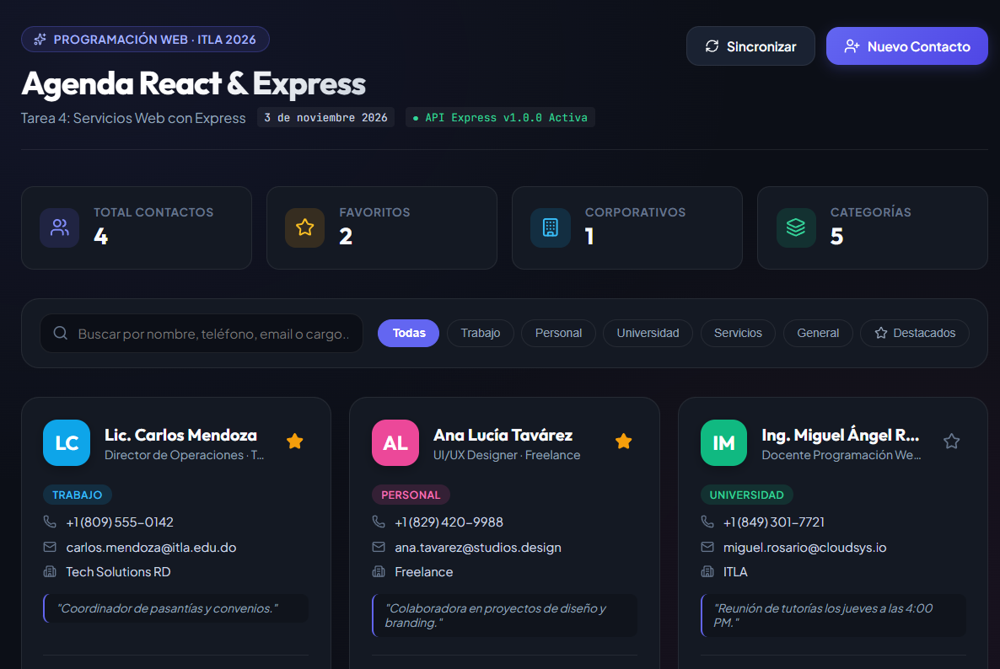
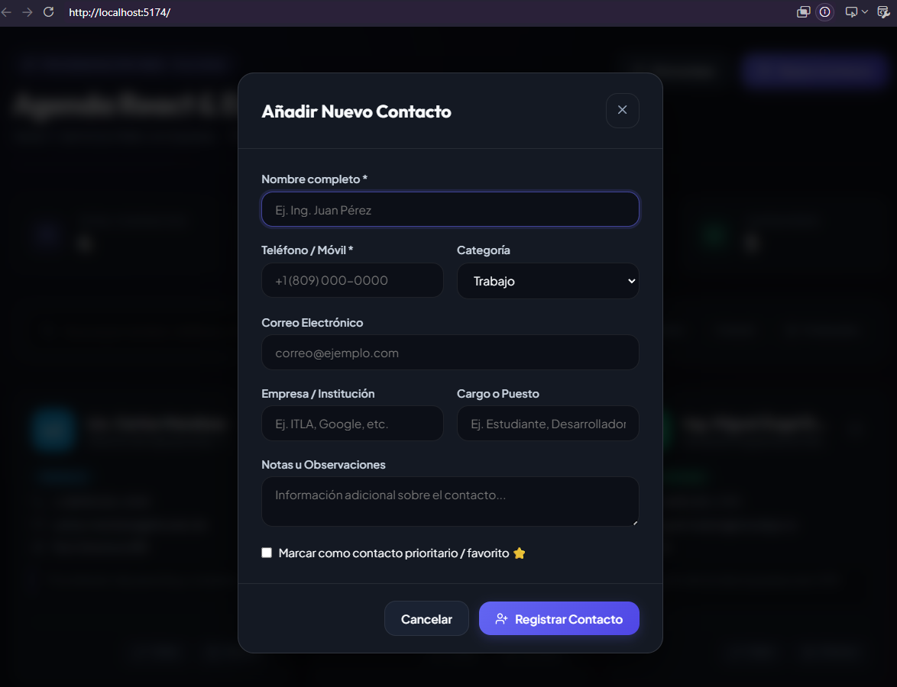
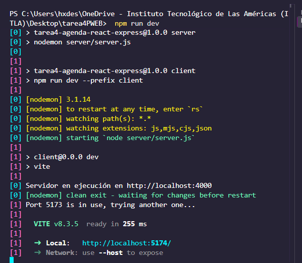

# Tarea 4: Agenda React - Servicios Web con Express

**Estudiante:** Adrian Brito Nelkitts  
**Matrícula:** 20251150  
**Materia:** Programación Web  
**Fecha:** 3 de noviembre 2026  

---

## 📸 Evidencias de la Aplicación







---

## 📌 Resumen del Proyecto

Aplicación Full Stack de gestión de contactos con arquitectura desacoplada:
- **Frontend (React + Vite):** Interfaz moderna y responsiva con tipografías Outfit y Plus Jakarta Sans, métricas en vivo, búsqueda interactiva, filtrado por categorías y gestión de favoritos.
- **Backend (Node.js + Express):** API RESTful modular (`/api/contactos`) que soporta operaciones CRUD completas y persistencia en archivo JSON.

---

## 🚀 Ejecución Rápida

1. **Instalar dependencias:**
   ```bash
   npm install
   cd client && npm install && cd ..
   ```

2. **Iniciar servidor y cliente en paralelo:**
   ```bash
   npm run dev
   ```

- Frontend: [http://localhost:5173](http://localhost:5173)
- Backend API: [http://localhost:4000/api/contactos](http://localhost:4000/api/contactos)
